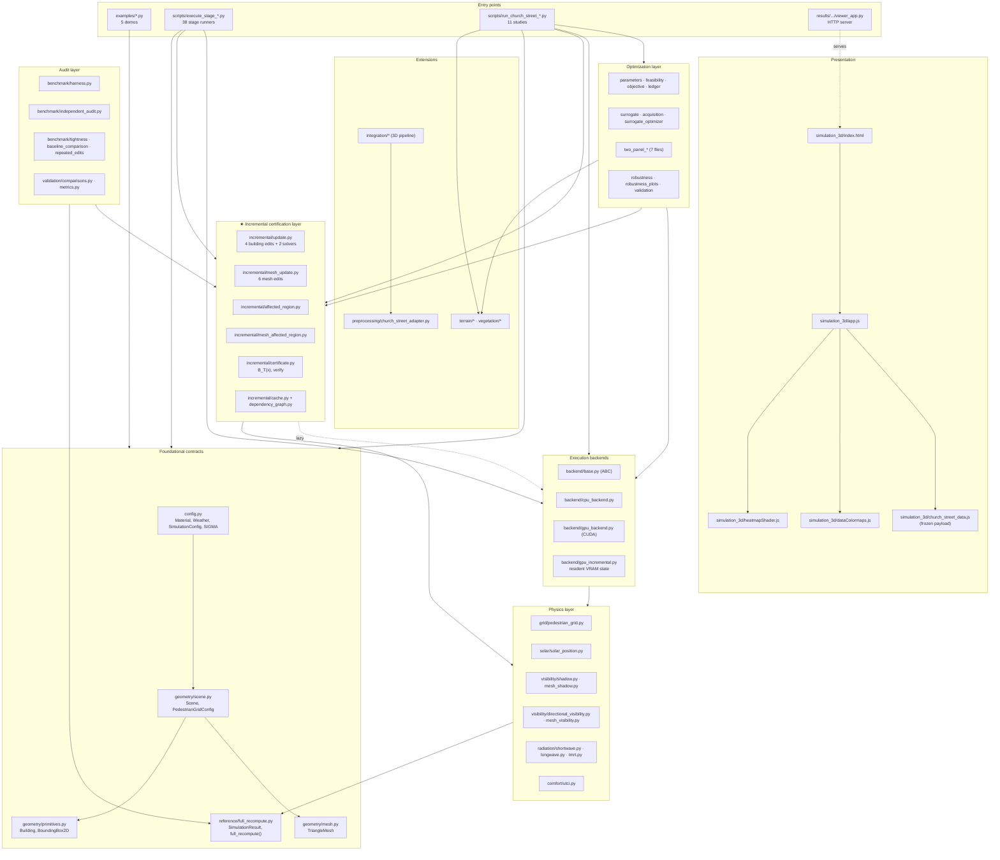
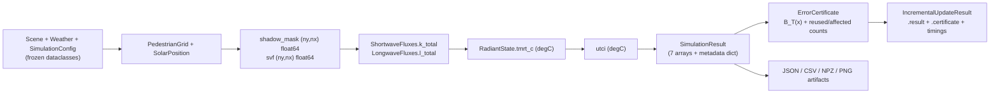
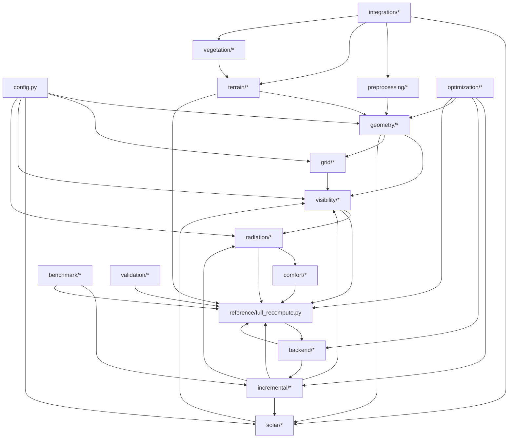
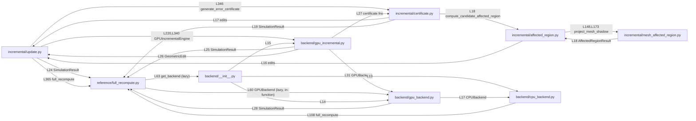
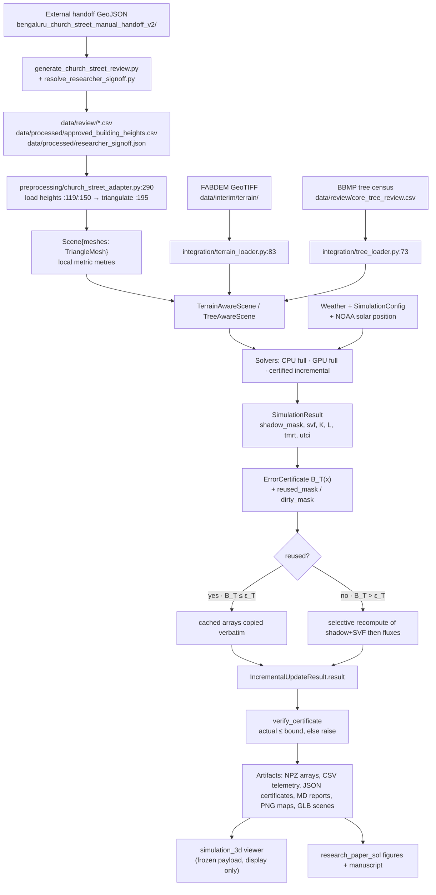

# SOLARAEUS — Project Structure Audit

> **STALE — describes the pre-overhaul tree at `pre-overhaul`.**
> The overhaul on branch `overhaul` has since moved and archived part of what
> this document describes. Paths named here as `src/solaraeus/`,
> `researchpaper/`, `weekly_report/`, `research_paper_sol/`, `context.md` and
> `tools/` no longer resolve. Read
> [REFACTOR_REPORT.md](REFACTOR_REPORT.md) §3 for the old -> new path table and
> §4 for which of this audit's "Inferred" claims (I1-I8) survived
> re-verification. Regenerating this file is Phase 10 of the overhaul and has
> **not** been done yet.

**Audit date:** 2026-10-10 · **Branch:** `main` · **Commit basis:** workspace HEAD
**Method:** every claim below is backed by a file:line citation read from the working tree, or by an AST-derived import graph built with a purpose-written extractor over all 255 Python files. Cycles and fan-in/out were computed with Tarjan SCC.

**Verification performed during this audit:** `python -m pytest -o pythonpath=src -q` → **457 passed, 42 warnings in 118.41s**. All 38 `results/stage_*` artifact directories exist.

---

## 1. Project summary (plain English)

### What it does
SOLARAEUS is a **research prototype that answers one question**: if you change one building in a city block — add it, delete it, raise it, move it — can you *reuse* the already-computed pedestrian-level thermal-comfort field instead of recomputing everything, **while proving mathematically that the reuse is safe**?

The safety proof is the whole point. For every grid cell the engine computes a cheap closed-form upper bound `B_T(x)` on the error *before* doing any expensive work. Cells where `B_T(x) ≤ ε_T` are declared clean and their cached Temperature Mean Radiant (T_mrt) values are reused verbatim. Only cells where the bound exceeds the tolerance are recomputed. Because the bound is derived from physics (shadow plume geometry + solid-angle SVF decay + Stefan-Boltzmann concavity) rather than tuned, the empirical error is provably under tolerance.

The repo headline result is a **0.95× slowdown on an 80 m domain that becomes a 23× speedup on a 320 m domain** — because the certificate lets you skip work proportionally to the *perturbed* area, not the *domain* area.

### Who it is for
A single researcher (repository has exactly 1 human contributor) building a conference publication. The consumers are:
- the researcher running stage scripts and reading JSON/CSV/Markdown audit artifacts,
- a paper reviewer reading `research_paper_sol/solaraeus.tex`,
- a stakeholder clicking around the Three.js "digital twin" in `simulation_3d/`.

### Tech stack (verified from imports, not from docs)

| Layer | Technology | Evidence |
|---|---|---|
| Language | Python 3.12.6 (62,286 LOC in `src`+`tests`+`scripts`+`examples`) | `README.md:5.1`; runtime observed |
| Numerics | NumPy, SciPy, `pythermalcomfort` (UTCI), `shapely` (polygons), `trimesh`, `pandas`, `scikit-learn` (tree ensembles), `pyproj`/`rasterio` (CRS + DEM), `matplotlib` (figures) | import counts: numpy 161, shapely 23, matplotlib 22, pyproj 15, trimesh 5, pandas 5, sklearn 2, rasterio 1 |
| GPU | CuPy + raw CUDA C++ kernels compiled via `cupy.RawModule` | `src/urban_comfort/backend/gpu_backend.py:32`, `:419`; 8 files import cupy |
| Web viewer | Three.js (vendored, non-module) + custom GLSL heatmap shader + WebGL | `simulation_3d/index.html:573-578` |
| Test runner | pytest with `-o pythonpath=src` (**not** installed as a package) | `README.md:6.1`; no `pyproject.toml`/`setup.py` anywhere |
| Publication | LaTeX / IEEEtran + TikZ + 300 DPI PNG | `research_paper_sol/solaraeus.tex` (577 lines) |

### The single most important structural fact
**There are two independent, unrelated Python packages in this repository.** `src/urban_comfort/` (94 files, 19,901 LOC) is the maintained engine. `src/solaraeus/` (7 files, 1,163 LOC) is an older, fully self-contained 2.5D heightfield implementation of the same idea. **They share zero imports** (verified: zero cross-package edges). `README.md` and `context.md` describe `urban_comfort` exclusively; `src/solaraeus/` is documented nowhere except by 3 test modules that still exercise it.

---

## 2. Directory tree with purpose

```
solaraeus/
├── .freebuff/                           Agent workspace metadata (project-id UUID only)
├── configs/
│   └── baseline_scene.json              Canonical 80×80m single-building scene (serialized Scene)
├── data/                                Curated geospatial + researcher-verified inputs (53 files)
│   ├── interim/                         Extracted terrain rasters & vegetation vectors (NOT authoritative)
│   │   ├── terrain/                     FABDEM clipped/aligned GeoTIFFs + alignment audits
│   │   └── vegetation/                  Tree inventory, photo-match logs, QC reports
│   ├── processed/                       PROMOTED authoritative data (approved heights, signoff.json)
│   └── review/                          Municipal review CSVs, decision tables, signoff forms
├── docs/
│   └── gpu_backend_architecture.md      GPU backend design + topology diagram (153 lines)
├── examples/                            5 standalone runnable demonstrations (2,221 LOC)
├── research_paper_sol/                  IEEE conference package: manuscript + 4 figs + 3 TikZ sources
├── researchpaper/                       17 third-party reference PDFs (literature, 154 MB) — NOT project code
├── results/                             1,101 checked-in outputs: 72 dirs, 483 JSON, 89 CSV, 198 PNG
│   ├── stage_05_* … stage_38_*/         Per-stage frozen audit artifacts (contract-tested by tests)
│   ├── church_street_*/                 Timestamped Church Street simulation runs
│   └── final_3d_integrated_simulation/  Master 3D pipeline output + viewer server + screenshots
├── scripts/                             59 pipelines/runners/generators (28,758 LOC)
├── simulation_3d/                       Interactive Three.js WebGL digital twin (6 hand-written JS/CSS + 2 vendored)
├── src/
│   ├── urban_comfort/                   ★ THE ENGINE (94 files, 19,901 LOC, 18 subpackages)
│   └── solaraeus/                       ⚠ LEGACY parallel implementation (7 files, 1,163 LOC, zero links to above)
├── tests/                               85 test modules (10,243 LOC)
├── weekly_report/                       4 .docx progress reports (binary, no code path)
├── README.md, context.md                Documentation (216 KB combined)
└── .gitignore                           Aggressive secret/dataset/venv exclusion rules
```

### `src/urban_comfort/` subpackage purposes (all verified)

| Subpackage | Files | Responsibility |
|---|---|---|
| `backend/` | 5 | CPU/GPU backend abstraction, CUDA kernels, GPU resident-state incremental engine |
| `benchmark/` | 11 | Reusable benchmark harness, parametric scenes, independent audit path, tightness metrics |
| `comfort/` | 2 | UTCI polynomial + 10 thermal stress categories |
| `geometry/` | 4 | AABB primitives, triangular meshes, scene container + synthetic generators |
| `grid/` | 2 | Pedestrian receptor grid, world↔index mapping |
| `incremental/` | 7 | ★ Core contribution: edits, affected regions, certificates, cache, dependency DAG |
| `integration/` | 7 | Church Street 3D pipeline: coords, terrain, trees, time-shadows, Tmrt/UTCI 3D |
| `optimization/` | 19 | Shade-panel parameterization, feasibility, objectives, ledgers, surrogates, optimizers |
| `preprocessing/` | 2 | Church Street GeoJSON → watertight TriangleMesh scenes |
| `radiation/` | 4 | Shortwave, longwave, air emissivity, Stefan-Boltzmann Tmrt inversion |
| `reference/` | 2 | Full-domain ground-truth recomputation + `SimulationResult` contract |
| `solar/` | 4 | NOAA solar position, Bengaluru sun model, parametric cloud model |
| `terrain/` | 4 | DTM grids, terrain-aware scenes, CPU/GPU terrain solvers |
| `validation/` | 3 | Array comparison metrics, shadow IoU, UTCI category agreement |
| `vegetation/` | 4 | Level-1 tree geometry (trunk+crown), tree-aware scenes/solvers |
| `visibility/` | 7 | Ray-AABB, ray-triangle, shadow masks, multi-azimuth SVF (AABB + mesh paths) |

---

## 3. Architecture diagram

### 3.1 Layered module view



### 3.2 Layer communication contract



The **shared data contract** through the whole engine is `SimulationResult` (`src/urban_comfort/reference/full_recompute.py:27`) — a dataclass of 7 NumPy arrays plus a free-form `metadata: Dict[str, Any]`. It is the single most-imported non-utility type (27 src importers). Nothing between `Scene` and `SimulationResult` uses JSON or files; everything is in-memory arrays.

---

## 4. Dependency graph

### 4.1 Package-level (verified edges, `line` = import site)



### 4.2 Critical-path detail (the certificate chain)



### 4.3 Fan-in ranking — the core files

| Rank | File | src importers | Why it matters |
|---|---|---|---|
| 1 | `src/urban_comfort/geometry/scene.py` | 36 | `Scene` is the universal input container |
| 2 | `src/urban_comfort/config.py` | 32 | `Weather`/`SimulationConfig`/`Material` contracts |
| 3 | `src/urban_comfort/grid/pedestrian_grid.py` | 29 | Every spatial field is indexed by this |
| 4 | `src/urban_comfort/reference/full_recompute.py` | 27 | Ground truth + `SimulationResult` type |
| 5 | `src/urban_comfort/solar/solar_position.py` | 26 | Every shadow/SVF call needs it |
| 6 | `src/urban_comfort/geometry/mesh.py` | 14 | Mesh generalization path |
| =7 | `comfort/utci.py`, `radiation/tmrt.py`, `incremental/update.py`, `geometry/primitives.py`, `optimization/parameters.py` | 12 each | Output + edit + parameterization contracts |

**Critical path:** `config` → `scene` → `pedestrian_grid` → `solar_position` → `shadow`/`directional_visibility` → `shortwave`/`longwave` → `tmrt` → `utci` → `SimulationResult` → `certificate` → reuse decision.

### 4.4 Highest fan-out (change-risk files)

| File | src deps | Note |
|---|---|---|
| `optimization/__init__.py` | 18 | Pure re-export barrel over all 19 optimization modules |
| `benchmark/independent_audit.py` | 15 | Deliberately re-derives everything independently |
| `backend/gpu_incremental.py` | 14 | Touches reference + incremental + backend simultaneously |
| `incremental/update.py` | 14 | Touches reference, certificate, backend, visibility |
| `optimization/two_panel_optimizer.py` | 14 | Orchestrator |
| `benchmark/baseline_comparison.py`, `optimization/robustness.py` | 13 | Compare/perturb across all paths |

---

## 5. Runtime flows

### Flow A — Single-building reference simulation (`examples/single_building.py`)
```
1. sys.path.insert(".../src")                       examples/single_building.py:11
2. Scene.load_json("configs/baseline_scene.json")   :22  → geometry/scene.py:209 → Scene.from_dict :141
3. Weather(301.15 K, 50%, 2 m/s, DNI 800, DHI 160)  :24  → config.py:32 (validated :41)
4. SimulationConfig(lat 40.7, lon -74.0, "2024-07-15 12:00:00")  :32 → config.py:57
5. full_recompute(scene, weather, config)           :42  → reference/full_recompute.py:43
   5a. calculate_solar_position(...)                full_recompute.py:74 → solar/solar_position.py:48
   5b. PedestrianGrid(scene.pedestrian_grid)        :77   → grid/pedestrian_grid.py:19
   5c. compute_direct_shadow_mask(scene, grid, sp)  :82   → visibility/shadow.py:16
   5d. compute_sky_view_factor(..., 32 az, 60 m)    :86   → visibility/directional_visibility.py:15
   5e. compute_shortwave_fluxes(...)                :100  → radiation/shortwave.py:24
       compute_longwave_fluxes(...)                :103  → radiation/longwave.py:39
       compute_tmrt(k_total, l_total)              :106  → radiation/tmrt.py:20
   5f. compute_utci(...)                            :114  → comfort/utci.py:19
6. get_thermal_stress_category(mean UTCI)           :58  → comfort/utci.py:58
7. Print stats + timing breakdown from result.metadata
```
Output: **stdout only.** No files written. ~6,400 cells.

### Flow B — Certified incremental update (the core scientific flow)
```
1. baseline_res = full_recompute(scene_baseline, ...)      examples/compare_full_incremental.py:88
2. edit = AddBuildingEdit(bldg_infill)                     :93   → incremental/update.py:38
   scene_edited, _ = edit.apply(scene_baseline)            :94   → update.py:45 (shallow copy + add)
3. edited_full_res = full_recompute(scene_edited, ...)     :100  ← ground truth for the audit
4. incremental_update_certified(...)                       :107  → incremental/update.py:325
   4a. generate_error_certificate(...)                     update.py:346 → certificate.py:108
       ├─ compute_candidate_affected_region(...)           certificate.py:124 → affected_region.py:70
       │    └─ project_box_shadow(...) shadow plume        affected_region.py:35
       │    └─ project_mesh_shadow(...) for meshes         → mesh_affected_region.py:21
       │    └─ if solar altitude < 5° → is_fallback=True   affected_region.py:70
       ├─ edit.apply(scene_before) → edit_bounds_3d        certificate.py:165
       ├─ compute_svf_decay_bound(...)                     certificate.py:166 → :63
       ├─ k_dir_max_step, c_diff, l_contrast               certificate.py:176-201
       ├─ B_T(x) = (S0/σ)^¼ − (max(1,S0−ΔS)/σ)^¼           certificate.py:214
       └─ dirty_mask = B_T > ε_T                           certificate.py:218
   4b. reconcile dependency graph + cache                 update.py (SimulationCache)
   4c. selective recompute: shadow+SVF only where dirty    update.py:208 incremental_update_exact
   4d. merge cached arrays with recomputed patches
5. verify_certificate(cert, inc.tmrt, full.tmrt)            :112  → certificate.py:235
   → raises CertificateViolationError if actual > bound      certificate.py:265
6. Write results/{baseline,edited_full,edited_incremental}_result.npz  :146,158,172
7. Write results/{error_map,affected_region}.png                        :240,278
8. Write results/{performance,certificate}.json                         :305,321
```
**This is the load-bearing flow of the entire repository.**

### Flow C — Church Street real-world pipeline (two distinct paths)

**Path C1 — mesh/scene path (paper's main experiment):**
```
scripts/run_church_street_preprocessing.py
  → preprocessing/church_street_adapter.py:290 process()
      :112 to_local_xy  → integration/coordinates.py:74 (WGS84→UTM43N→local)
      :119 load_core_heights ← data/processed/approved_building_heights.csv
      :150 load_context_heights ← data/review/final_context_tree_decision_table.csv
      :195 triangulate_and_extrude → geometry/mesh.py TriangleMesh
  → results/church_street_preprocessing_<UTC>/ artifacts
scripts/run_church_street_static_simulation.py     → reference/full_recompute.py (28,120 cells, 123 bldgs)
scripts/run_church_street_shade_panel_simulation.py→ mesh edits on ShadePanelParams
scripts/run_church_street_shade_panel_incremental.py→ incremental_update_certified
scripts/run_church_street_gpu_simulation.py        → backend/gpu_backend.py
scripts/run_church_street_shade_panel_gpu_incremental.py → backend/gpu_incremental.py
scripts/run_church_street_intervention_optimization.py   → optimization/optimizer.py
scripts/run_church_street_surrogate_optimization.py      → optimization/surrogate_optimizer.py
scripts/run_church_street_two_panel_optimization.py      → optimization/two_panel_optimizer.py
scripts/run_church_street_two_panel_robustness.py        → optimization/robustness.py + robustness_plots.py
```

**Path C2 — 3D integration pipeline (the viewer's data source):**
```
scripts/execute_final_3d_integrated_simulation.py:70 main()  (898-line orchestrator, Parts 1–18)
  → integration/coordinates.py:133        transformer singleton
  → integration/terrain_loader.py:183     terrain_loader (FABDEM GeoTIFF or synthetic profile)
  → integration/tree_loader.py:247        tree_loader (data/review/core_tree_review.csv)
  → integration/tree_geometry_builder.py:97
  → solar/sun_model.py:217                sun_model (Bengaluru 12.9749N 77.6054E IST)
  → solar/cloud_model.py:248              cloud_model (parametric, NOT observed)
  → integration/time_shadowing.py:203     time_shadowing_engine
  → integration/tmrt_3d.py:221            tmrt_3d_engine
  → integration/utci_3d.py:73             utci_3d_engine
  → OUTPUT results/final_3d_integrated_simulation/{scene/*.glb, ray_tracing/*, heatmaps/*, optimization/*}
```

### Flow D — Interactive 3D viewer
```
results/final_3d_integrated_simulation/viewer/viewer_app.py:14
   DIRECTORY = <repo>/simulation_3d      :15
   TCPServer on port 8080                 :34
   webbrowser.open(index.html)            :41
→ simulation_3d/index.html:573 loads vendor/three.min.js
                         :574 vendor/OrbitControls.js
                         :575 church_street_data.js   → window.CHURCH_STREET_DATA
                         :576 dataColormaps.js        → window.SOLARAEUS_COLORMAPS
                         :577 heatmapShader.js        → window.SOLARAEUS_HEATMAP_SHADER
                         :578 app.js                  → init() on DOMContentLoaded (app.js:1747)
   app.js:459,529,622,694  read window.CHURCH_STREET_DATA.{buildings,trees,interventions,thermal_grid}
   app.js:728,731,818      build heatmap material via SOLARAEUS_COLORMAPS + SOLARAEUS_HEATMAP_SHADER
   User interactions: style presets, camera bookmarks, opacity/contours/cloud sliders,
                      shadow & tree toggles, time-of-day slider → uniform updates only
```
**No physics happens in the browser.** Every number in the viewer comes from the frozen `church_street_data.js` payload written by the Python pipeline.

### Flow E — Stage runner pattern (38 scripts)
All 38 `scripts/execute_stage_*.py` follow one shape, e.g. `execute_stage_30_cpu_tree_shadow.py`:
```
1. sys.path.insert(repo_root/"src")                      :23
2. import urban_comfort.{config,geometry,terrain,vegetation}
3. create_base_scene() — canonical synthetic scene         :39
4. run a fixed battery of controlled scenarios
5. write results/stage_NN_<name>/*.json + *.md + *.csv
6. emit a status token, e.g. "STAGE_30_CPU_TREE_SHADOW_REFERENCE_COMPLETE"
```
The token is then asserted by the matching test module, e.g.
`tests/test_stage_30_cpu_tree_shadow.py:35` asserts `status == "STAGE_30_CPU_TREE_SHADOW_REFERENCE_COMPLETE"` and `:47` asserts the token.

### Flow F — Publication validation campaign
```
examples/run_publication_validation.py:717 main()
examples/run_all_evaluations.py:643      main()   → 5 suites + 7 figures → results/plots/
examples/run_independent_audit.py:458    main()   → independent_audit.py:46 (NOT reusing certificate.py)
scripts/generate_ieee_figures.py                  → research_paper_sol/fig1..fig4 PNG
```

---

## 6. File relationship table

Legend: **E** = external touchpoints. All `src/` files listed individually; tests/scripts grouped by pattern (they repeat identically).

### 6.1 Core physics (`src/urban_comfort/`)

| File | Role | Depends on | Used by | External touchpoints |
|---|---|---|---|---|
| `config.py` | Data model | — | 32 src, all scripts/examples | none (no I/O) |
| `geometry/primitives.py` | Data model | — | mesh, scene, update, scripts | none |
| `geometry/mesh.py` | Data model | — | 14 src; `from_dict` :188 for JSON | `TriangleMesh.to_dict` :176 → JSON |
| `geometry/scene.py` | Data model + scene generators | config, primitives, mesh | 36 src; `save_json`/`load_json` :204/:209 | reads/writes `*.json` scene files |
| `grid/pedestrian_grid.py` | Utility | config (via scene) | 29 src | none |
| `solar/solar_position.py` | Core logic | — | 26 src | none (pure astronomy) |
| `solar/sun_model.py` | Core logic | coordinates? no; scene :138 | 3D pipeline, tests | writes `sun_path.csv` (:138), `sun_path.glb` (:171) |
| `solar/cloud_model.py` | Core logic (parametric, self-labelled unvalidated) | — | 3D pipeline, tests | `MANDATORY_LABELS` :45 |
| `visibility/ray_intersection.py` | Core logic | — | shadow, update | none |
| `visibility/shadow.py` | Core logic (AABB path) | scene, grid, solar, ray_intersection | full_recompute, tests | none |
| `visibility/directional_visibility.py` | Core logic (AABB SVF) | scene, grid, ray_intersection | full_recompute, tests | none |
| `visibility/mesh_ray_intersection.py` | Core logic (Möller–Trumbore) | mesh | mesh_shadow, mesh_visibility, tests | none |
| `visibility/mesh_shadow.py` | Core logic (mesh path) | mesh_ray_intersection | backend, tests | none |
| `visibility/mesh_visibility.py` | Core logic (mesh SVF, rasterized height grid :19) | mesh_ray_intersection, mesh | backend, tests | none |
| `radiation/shortwave.py` | Core logic | config | full_recompute, tests | none |
| `radiation/longwave.py` | Core logic | config | full_recompute, certificate (air emissivity), tests | none |
| `radiation/tmrt.py` | Core logic | — | full_recompute, tests | none |
| `comfort/utci.py` | Core logic | — | 12 src, scripts | **external lib `pythermalcomfort`** |
| `reference/full_recompute.py` | Orchestrator + `SimulationResult` contract | config, scene, grid, solar, shadow, visibility, radiation, comfort | 27 src, all examples | lazy-imports backend :60,:63 |

### 6.2 Incremental certification (the contribution)

| File | Role | Depends on | Used by | External touchpoints |
|---|---|---|---|---|
| `incremental/update.py` | Core logic — `GeometricEdit` ABC + 4 edits (:28–:123), `incremental_update_exact` :208, `incremental_update_certified` :325 | reference :24, certificate :346, backend/gpu_incremental :220 | 12 src, 25+ scripts, tests | none directly; delegates GPU |
| `incremental/mesh_update.py` | Core logic — 6 mesh edits (:19–:157) | mesh, scene, primitives | tests, two_panel_optimizer, scripts | none |
| `incremental/affected_region.py` | Core logic — shadow plume projection :35, candidate region :70, low-sun fallback | update :16, mesh_affected_region :148 | certificate, tests | none |
| `incremental/mesh_affected_region.py` | Core logic — mesh vertex plume :21, candidate region :87 | affected_region :18, mesh | update path, backend | none |
| `incremental/certificate.py` | ★ Core logic — `ErrorCertificate` :28, `compute_svf_decay_bound` :63, `generate_error_certificate` :108, `verify_certificate` :235, `CertificateViolationError` :22 | update :17, affected_region :18, reference :19, longwave | update, gpu_incremental, 15 scripts, 6 tests | none (raises on violation) |
| `incremental/cache.py` | Utility — SHA-256 fingerprinting :19–:39, `SimulationCache` :74 | scene, dependency_graph, reference | harness, tests | none |
| `incremental/dependency_graph.py` | Data model — field constants :12–:26, `DependencyGraph` DAG :74 | — | cache, tests | none |

### 6.3 Execution backends

| File | Role | Depends on | Used by | External touchpoints |
|---|---|---|---|---|
| `backend/base.py` | API/ABC — `FlattenedSceneGeometry` :22, `SimulationBackend` ABC :226 | scene, grid, solar, config | cpu/gpu backends | none |
| `backend/cpu_backend.py` | Core logic — wraps trusted CPU solvers :41,:68,:102 | base, visibility, reference :108 | `backend/__init__`, gpu_backend, tests | none |
| `backend/gpu_backend.py` | Core logic + GPU — `CUDA_KERNELS_SOURCE` :32, `is_cupy_available` :388, `GPUBackend` :397 | base, cpu_backend :17, reference :28 | `backend/__init__`, gpu_incremental | **CuPy / CUDA JIT**; needs NVIDIA GPU |
| `backend/gpu_incremental.py` | ★ Core logic + GPU — `GPUResidentState` :61, `GPUIncrementalEngine` :97, `execute_certified_update` :185, `execute_exact_update` :452 | reference :25, update :26, certificate :27, gpu_backend :31 | update :220, optimizer, scripts | **persistent VRAM**; longest-lived mutable state in repo |
| `backend/__init__.py` | Factory/API — `is_gpu_available` :20, `get_backend` :25 | cpu_backend :13, gpu_backend :14, gpu_incremental :15 | full_recompute :63, scripts | env-dependent availability |

### 6.4 Extensions (terrain, vegetation, preprocessing, 3D integration)

| File | Role | Depends on | Used by | External touchpoints |
|---|---|---|---|---|
| `terrain/dtm.py` | Core logic — `TerrainGrid` :15, factories :49–:89, bilinear sample :89, Horn normals :138 | — | terrain_scene, tests | none (arrays only) |
| `terrain/terrain_scene.py` | Data model — `TerrainAwareScene` :17 | scene, dtm | terrain_solver, tree_scene, scripts | none |
| `terrain/terrain_solver.py` | Core logic — `TerrainAwareCPUSolver` :29 | terrain_scene, visibility, radiation | scripts, tests | none |
| `terrain/gpu_terrain.py` | Core logic + GPU — kernel :29, `TerrainAwareGPUBackend` :136, `incremental_simulate` :256 | terrain_scene, gpu_backend, dtm | scripts, tests | **CuPy / CUDA** |
| `vegetation/tree.py` | Data model — `Tree` :16, ray test :49, `get_core_trees` :118 | — | tree_scene, tree_solver, gpu_tree, scripts | hard-coded T08–T13 core tree data in source |
| `vegetation/tree_scene.py` | Data model — `TreeAwareScene` :21 | terrain_scene, tree | tree_solver, gpu_tree | none |
| `vegetation/tree_solver.py` | Core logic — `TreeAwareCPUSolver` :30, `simulate_incremental` :177 | tree_scene, visibility, radiation | scripts, tests | none |
| `vegetation/gpu_tree.py` | Core logic + GPU — kernel :37, `TreeAwareGPUBackend` :148 | tree_scene, gpu_backend, tree_solver | scripts, tests | **CuPy / CUDA** |
| `preprocessing/church_street_adapter.py` | ★ Ingest — `PreprocessingConfig` :37, `to_local_xy` :112, `load_core_heights` :119, `load_context_heights` :150, `triangulate_and_extrude` :195, `process` :290 | coordinates, mesh, scene, shapely | 3D pipeline, church street scripts, tests | **reads** `data/processed/approved_building_heights.csv`, `data/processed/researcher_signoff.json`, `data/review/*.csv`, `bengaluru_church_street_manual_handoff_v2/.../data/processed/*.geojson` |
| `integration/coordinates.py` | Utility — `CoordinateSystemDefinition` :23, `CoordinateTransformer` :37, WGS84↔UTM43N↔local↔Three.js, `transformer` singleton :133 | pyproj | adapter, 3D pipeline, tests | **EPSG:4326 / EPSG:32643**; Three.js Y-up axis flip :84 |
| `integration/terrain_loader.py` | Ingest — `TerrainLoader` :47, `sample_elevation` :83, `generate_mesh` :105, singleton :183 | dtm, rasterio | 3D pipeline, tests | **reads** `data/interim/terrain/fabdem_local_reference.tif` :59, `fabdem_clipped_utm43.tif` :63; labels :50 |
| `integration/tree_loader.py` | Ingest — `TreeRecord` :32, `TreeLoader` :52, singleton :247 | pytest? no; csv/json | 3D pipeline, tests | **reads** `data/review/core_tree_review.csv` :66, `data/review/tree_dimension_uncertainty_bounds.csv` :68 |
| `integration/tree_geometry_builder.py` | Core logic — `TreeGeometryBuilder` :18, `build_tree_mesh` :24, `build_forest_scene` :79 | tree_loader, terrain_loader, trimesh | 3D pipeline, tests | writes GLB via trimesh |
| `integration/time_shadowing.py` | Core logic — `ShadowStepResult` :29, `TimeShadowingEngine` :43, `simulate_day` :78, singleton :203 | solar_position, cloud_model | 3D pipeline, tests | none |
| `integration/tmrt_3d.py` | Core logic — `Tmrt3DResult` :32, `Tmrt3DEngine` :47, `compute_field` :70, singleton :221 | solar_position, cloud_model | 3D pipeline, tests | none |
| `integration/utci_3d.py` | Core logic — `UTCI3DResult` :23, `UTCI3DEngine` :32, `compute_field` :38, singleton :73 | pythermalcomfort | 3D pipeline, tests | **external lib `pythermalcomfort`** |

### 6.5 Optimization (19 files, 4,800 LOC)

| File | Role | Depends on | Used by | External touchpoints |
|---|---|---|---|---|
| `optimization/parameters.py` | Data model — `ShadePanelParams` :19, `ParameterBounds` :125, `build_panel_geometry` :323, canonical Church St bounds :290 | mesh, shapely | 25 src/scripts/tests | none |
| `optimization/feasibility.py` | Core logic — `RejectionReason` enum :25, `check_feasibility` :116 | scene, shapely | optimizer, surrogate_optimizer, tests | none |
| `optimization/objective.py` | Core logic — `compute_objective` :67 | reference | optimizer, surrogate, tests | none |
| `optimization/ledger.py` | Persistence — `CandidateRecord` :22, `CandidateLedger` :63, `save_json` :97, `save_csv` :102 | parameters | optimizer, surrogate, tests | **writes JSON + CSV** |
| `optimization/optimizer.py` | Orchestrator — `OptimizationEngine` :45, `evaluate_candidate` :87, run_* :248–:362 | parameters, feasibility, objective, ledger, update, gpu_incremental | scripts, tests | delegates GPU |
| `optimization/surrogate.py` | Core logic + ML — `SurrogateModel` :130, `fit` :178, `predict_batch` :294, `FallbackSurrogateModel` :362 | sklearn, ledger | surrogate_optimizer, tests | **`scikit-learn`**, optional |
| `optimization/acquisition.py` | Core logic — LCB :32, EI :44, `CandidateAcquisitionEngine` :83 | surrogate, feasibility, parameters | surrogate_optimizer, tests | none |
| `optimization/surrogate_optimizer.py` | Orchestrator — `SurrogateOptimizationEngine` :72, `load_initial_dataset` :142, `run` :180 | surrogate, acquisition, optimizer, ledger | scripts, tests | reads prior-stage ledger JSON |
| `optimization/validation.py` | Audit — `TOLERANCES_INCREMENTAL` :32, `validate_candidate_multi_path` :218, `run_multi_path_validation_suite` :358 | update, gpu_incremental, reference, comparisons | scripts, tests | none |
| `optimization/two_panel_parameters.py` | Data model — `TwoPanelParams` (14-D) :20, `canonicalize` :102, `TwoPanelBounds` :199 | parameters, mesh | two-panel stack | none |
| `optimization/two_panel_feasibility.py` | Core logic — 13 rejection codes :32, `check_two_panel_feasibility` :92 | feasibility, shapely | two-panel stack | none |
| `optimization/two_panel_objective.py` | Core logic — `compute_two_panel_objective` :116, `compute_pareto_front` :239 | reference, pandas | two-panel stack | **`pandas`** |
| `optimization/two_panel_ledger.py` | Persistence — `TwoPanelCandidateLedger` :114, `save_json` :157, `save_csv` :162, `to_dataframe` :228 | pandas | two-panel stack | **writes JSON/CSV**, reads via `from_dict` :69 |
| `optimization/two_panel_surrogate.py` | Core logic + ML — `extract_two_panel_features` :98, `TwoPanelSurrogateModel` :145 | sklearn | two-panel stack | **`scikit-learn`** |
| `optimization/two_panel_acquisition.py` | Core logic — `generate_two_panel_seeds` :61, `propose_batch` :167 | two_panel_surrogate, feasibility | two-panel stack | reads Stage-1/2 ledgers |
| `optimization/two_panel_optimizer.py` | ★ Orchestrator — `TwoPanelOptimizationEngine` :112, `evaluate_candidate` :167, `run_optimization` :332 | 14 src modules | scripts, 2 tests | GPU + ledger I/O |
| `optimization/two_panel_validation.py` | Audit — `TwoPanelMultiPathSummary` :83, `validate_two_panel_multi_path` :99 | update, gpu_incremental | scripts, tests | none |
| `optimization/robustness.py` | Audit — 10 study dimensions :60–:141, `get_standard_*` :157–:311, `evaluate_candidate_at_condition` :413 | two-panel stack, config | robustness script, tests | reads/writes ledgers |
| `optimization/robustness_plots.py` | Report — 13 publication figures :50–:449 | matplotlib | robustness script | **writes 13 PNGs** |
| `optimization/__init__.py` | API barrel — 18 re-export blocks :9–:60 | all optimization modules | scripts, tests | none |

### 6.6 Audit / benchmark layer

| File | Role | Depends on | Used by | External touchpoints |
|---|---|---|---|---|
| `benchmark/harness.py` | Audit — `SOFTWARE_VERSION` :32, `BenchmarkRecord` 30-field schema :36, `run_benchmark_trial` :101, `run_repeated_benchmark_trials` :253 | update, certificate, cache, reference | scripts, examples | `tracemalloc`/`psutil` RSS :82 |
| `benchmark/scenes.py` | Test util — `create_scaling_scene` :18 (80/160/320/640 m × 3 densities) | scene, primitives | tests | none |
| `benchmark/independent_audit.py` | ★ Audit — `audit_certificate_independently` :46 (deliberately does NOT call `verify_certificate`), `run_mutation_tests` :246, `run_detailed_timing_audit` :466, `build_provenance_record` :555 | reference, update, certificate-adjacent | examples, tests | **git subprocess**, platform probes |
| `benchmark/independent_reference.py` | Audit — analytical closed forms :34 shadow length, :42 view factor, :64 suite, `EXTERNAL_SOLWEIG_COMPATIBILITY_AUDIT` :163 | reference | examples | writes CSV |
| `benchmark/baseline_comparison.py` | Audit — `run_non_certified_dirty_region_update` :57, `compare_all_baselines` :140 | update, certificate, update.exact | examples, tests | none |
| `benchmark/repeated_edits.py` | Audit — 5-step sequential edit sequence :58 | update, reference | examples | none |
| `benchmark/tightness.py` | Audit — `CertificateTightnessMetrics` :19, `evaluate_certificate_tightness` :46 | certificate | examples | none |
| `benchmark/aabb_vs_mesh_benchmark.py` | Benchmark — :42 canonical scenes, :109 `build_scene_pair`, :208 runner | scene, mesh, reference | tests | writes CSV/JSON |
| `benchmark/mesh_certificate_audit.py` | Benchmark — 8 mesh scenarios :47–:120, runner :143 | mesh_update, certificate, update | tests | writes CSV |
| `benchmark/mesh_scaling_benchmark.py` | Benchmark — `create_mesh_scaling_scene` :35, `run_scaling_trial` :86, runner :168 | mesh, scene, reference | tests | writes CSV/JSON |
| `validation/comparisons.py` | Test util — `compare_arrays` :28, `compare_results` :66, `format_comparison_summary` :106 | reference | 12+ tests, validation stack | none |
| `validation/metrics.py` | Test util — shadow IoU :13, UTCI category agreement :29, error percentiles :46 | — | tests | none |

### 6.7 Legacy package `src/solaraeus/` (7 files — isolated)

| File | Role | Depends on | Used by | External touchpoints |
|---|---|---|---|---|
| `solaraeus/__init__.py` | Package marker :5 | — | nothing | `__version__ = "0.1.0"` |
| `solaraeus/core/geometry.py` | Core logic — 2.5D heightfield `UrbanGrid` :33, edits :77–:192 | — | solweig, bounds, solver, runner, adversarial | none |
| `solaraeus/core/solweig.py` | Core logic — `SIGMA` :15, `WeatherParameters` :19, `SOLWEIGConfig` :36, `SOLWEIGState` :48, shadow :59, SVF :142, fluxes :211, `ReferenceSOLWEIGSolver` :296 | geometry | bounds, solver, runner, adversarial | none |
| `solaraeus/incremental/bounds.py` | Core logic — `CertificateResult` :17, `compute_shadow_frustum_mask` :26, `compute_svf_decay_bound` :80, `evaluate_certificate` :132 | geometry, solweig | solver | none |
| `solaraeus/incremental/solver.py` | Core logic — `IncrementalUpdateResult` :20, `IncrementalSOLWEIGSolver` :41, `apply_edit` :58 | geometry, solweig, bounds | runner | none |
| `solaraeus/benchmark/runner.py` | Benchmark — `VerificationRecord` :22, `run_experiment` :48, `run_suite` :116 | geometry, solweig, solver | tests | none |
| `solaraeus/benchmark/adversarial.py` | Test util — `AdversarialCase` :23, `create_adversarial_suite` :32 | geometry | runner, tests | none |

### 6.8 Scripts, examples, tests (grouped — identical patterns repeat)

| Group | Files | Role | Depends on (all verified) | External touchpoints |
|---|---|---|---|---|
| Examples | `single_building.py`, `compare_full_incremental.py`, `run_all_evaluations.py`, `run_independent_audit.py`, `run_publication_validation.py` | Entry point / demo | config, scene, primitives, full_recompute, update, certificate, benchmark/* | write `results/*.npz`, `*.png`, `*.json`, `results/plots/*` |
| Stage runners 05–38 | 34 × `execute_stage_*.py` | Entry point / stage pipeline | config, scene, primitives, mesh, terrain/*, vegetation/*, update, certificate, backend/*, optimization/* | write `results/stage_NN_*/*.json|.csv|.md`; emit status tokens |
| Stage gate | `execute_stages_27_to_38_blocked_gates.py` | Entry point / guard | none (pure file checks) | reads stage manifests |
| Church Street | 11 × `run_church_street_*.py` | Entry point / study | preprocessing, integration/*, update, backend/*, optimization/* | read `data/**`, write `results/church_street_*<UTC>/` |
| Master 3D | `execute_final_3d_integrated_simulation.py` (898 lines) | Entry point / orchestrator | integration/*, solar/*, preprocessing | read `data/**` + handoff GeoJSON; write `results/final_3d_integrated_simulation/**` |
| Report generators | 7 × `generate_*.py` | Report / script | matplotlib, PIL, hashlib | write `results/**`, `research_paper_sol/*.png` |
| Tooling | `resolve_researcher_signoff.py`, `generate_church_street_review.py`, `verify_ui_quality.py` | Entry point / tooling | hashlib, PIL | read `data/**`, `simulation_3d/**`; write `data/processed/*`, `data/review/*`, `results/.../ui_quality/*` |
| `run_first_milestone.py` | Historical | Entry point | urban_comfort.* | writes `results/` |
| Tests — core | 45 modules (`test_geometry`, `test_error_bounds`, `test_incremental_updates`, `test_mesh_*`, `test_two_panel_*`, `test_surrogate_*`, `test_intervention_*`, `test_validation_*`, `test_solar_position`, `test_shadows`, `test_ray_*`, `test_pedestrian_grid`, `test_cache_and_dependencies`, `test_affected_region`, `test_adversarial_*`, `test_extended_adversarial`, `test_aabb_vs_mesh_benchmarks`, `test_mesh_certificate_audits`, `test_mesh_scaling_benchmarks`, `test_mutation_audits`, `test_certificate_soundness`, `test_solweig_reference`, `test_adversarial_suite`, `test_gpu_backend`, `test_gpu_incremental`, `test_church_street_*`, `test_stage_13_geographic_feasibility`, `test_full_recompute`, `test_validation_comparisons`) | Test | `src/urban_comfort/**`, `src/solaraeus/**` (3 modules), `configs/baseline_scene.json` | none (pure in-memory) |
| Tests — artifact contracts | 40 modules: `test_stage_10…38`, `test_stages_27_to_38_gates`, `test_final_3d_*`, `test_tree_geometry_review` | Test | **no source imports at all** — they read frozen JSON from `results/stage_NN_*/` and assert status tokens | **reads `results/**`**; e.g. `tests/test_stage_30_cpu_tree_shadow.py:23` |

### 6.9 Per-file test and documentation coverage

Derived by resolving every `tests/*.py` import back to its source module (test names abbreviated by stripping `test_` and `.py`). **Bold = zero coverage.**

| Source file | Tests covering it | Docs describing it |
|---|---|---|
| `config.py` | 22 modules: adversarial_cases, affected_region, cache_and_dependencies, error_bounds, extended_adversarial, full_recompute, geometry, gpu_backend, gpu_incremental, incremental_updates, intervention_optimization, mesh_*, surrogate_optimization, two_panel_*, validation_comparisons | README, context.md |
| `geometry/scene.py` | 26 modules (widest-tested file) | context.md |
| `geometry/primitives.py` | 18 modules | context.md |
| `geometry/mesh.py` | 15 modules: church_street_preprocessing, church_street_shade_panel_simulation, gpu_*, mesh_* (6), ray_triangle_intersection, surrogate_optimization, two_panel_optimization | context.md |
| `grid/pedestrian_grid.py` | pedestrian_grid (dedicated, 5 tests) + 15 transitive | context.md |
| `solar/solar_position.py` | solar_position (dedicated, 4 tests) + 9 transitive | context.md |
| `solar/sun_model.py` | final_3d_sun_model, final_3d_tmrt | **none** |
| `solar/cloud_model.py` | final_3d_cloud_model, final_3d_tmrt | **none** |
| `visibility/ray_intersection.py` | ray_intersections (dedicated, 5 tests) | context.md |
| `visibility/shadow.py` | shadows (dedicated) + affected_region, mesh_* | context.md |
| `visibility/directional_visibility.py` | shadows, mesh_visibility, mesh_adversarial | context.md |
| `visibility/mesh_ray_intersection.py` | ray_triangle_intersection (dedicated), mesh_adversarial | context.md |
| `visibility/mesh_shadow.py` | mesh_shadows | context.md |
| `visibility/mesh_visibility.py` | mesh_visibility (dedicated) | context.md |
| `radiation/shortwave.py` | mesh_mutation_audit | context.md |
| `radiation/longwave.py` | mesh_mutation_audit | context.md |
| `radiation/tmrt.py` | mesh_mutation_audit | context.md |
| `comfort/utci.py` | mesh_mutation_audit | context.md |
| `reference/full_recompute.py` | full_recompute (dedicated, 4 tests) + 14 transitive | context.md |
| `incremental/update.py` | incremental_updates (dedicated, 4) + adversarial_cases, error_bounds, extended_adversarial, mesh_* | context.md |
| `incremental/certificate.py` | error_bounds (dedicated, 8) + adversarial_cases, extended_adversarial, gpu_incremental, mesh_*, two_panel_optimization | context.md |
| `incremental/affected_region.py` | affected_region (dedicated, 5) + adversarial_cases, mesh_affected_region, two_panel_optimization | context.md |
| `incremental/mesh_affected_region.py` | mesh_affected_region (dedicated) | context.md |
| `incremental/mesh_update.py` | 7 modules: gpu_incremental, mesh_*, two_panel_* | context.md |
| `incremental/cache.py` | cache_and_dependencies (dedicated, 6 tests) | context.md |
| `incremental/dependency_graph.py` | cache_and_dependencies | context.md |
| `backend/__init__.py` | gpu_backend | context.md |
| `backend/base.py` | **none** | **none** |
| `backend/cpu_backend.py` | **none** | **none** |
| `backend/gpu_backend.py` | gpu_incremental | docs/gpu_backend_architecture.md, context.md |
| `backend/gpu_incremental.py` | gpu_incremental, surrogate_optimization, two_panel_optimization, two_panel_robustness | docs/gpu_backend_architecture.md, context.md |
| `benchmark/scenes.py` | mutation_audits | context.md |
| `benchmark/independent_audit.py` | mesh_adversarial, mesh_mutation_audit, mutation_audits | context.md |
| `benchmark/aabb_vs_mesh_benchmark.py` | aabb_vs_mesh_benchmarks (dedicated) | context.md |
| `benchmark/mesh_certificate_audit.py` | mesh_certificate_audits (dedicated) | context.md |
| `benchmark/mesh_scaling_benchmark.py` | mesh_scaling_benchmarks (dedicated) | context.md |
| `benchmark/harness.py` | **none** | context.md |
| `benchmark/baseline_comparison.py` | **none** | context.md |
| `benchmark/independent_reference.py` | **none** | context.md |
| `benchmark/repeated_edits.py` | **none** | context.md |
| `benchmark/tightness.py` | **none** | context.md |
| `validation/comparisons.py` | validation_comparisons (dedicated, 7 tests), incremental_updates | context.md |
| `validation/metrics.py` | validation_comparisons | context.md |
| `preprocessing/church_street_adapter.py` | church_street_preprocessing (dedicated) | context.md |
| `integration/coordinates.py` | final_3d_coordinate_alignment (dedicated) | **none** |
| `integration/terrain_loader.py` | final_3d_terrain_loading | **none** |
| `integration/tree_loader.py` | final_3d_tree_map_placement | **none** |
| `integration/tree_geometry_builder.py` | final_3d_tree_map_placement | **none** |
| `integration/time_shadowing.py` | final_3d_time_shadowing | **none** |
| `integration/tmrt_3d.py` | final_3d_tmrt | **none** |
| `integration/utci_3d.py` | final_3d_utci | **none** |
| `optimization/parameters.py` | intervention_optimization, stage_13_geographic_feasibility, surrogate_optimization, two_panel_* | context.md |
| `optimization/feasibility.py` | intervention_optimization, stage_13_geographic_feasibility, surrogate_optimization, two_panel_* | context.md |
| `optimization/objective.py` | intervention_optimization, surrogate_optimization, two_panel_* | context.md |
| `optimization/ledger.py` | intervention_optimization, surrogate_optimization, two_panel_optimization | context.md |
| `optimization/optimizer.py` | intervention_optimization, surrogate_optimization | context.md |
| `optimization/surrogate.py` | surrogate_optimization (dedicated) | context.md |
| `optimization/acquisition.py` | surrogate_optimization | context.md |
| `optimization/surrogate_optimizer.py` | surrogate_optimization | context.md |
| `optimization/validation.py` | intervention_optimization, surrogate_optimization | README, context.md |
| `optimization/two_panel_parameters.py` | two_panel_optimization, two_panel_robustness | context.md |
| `optimization/two_panel_feasibility.py` | two_panel_optimization, two_panel_robustness | context.md |
| `optimization/two_panel_objective.py` | two_panel_optimization, two_panel_robustness | context.md |
| `optimization/two_panel_ledger.py` | two_panel_optimization, two_panel_robustness | context.md |
| `optimization/two_panel_surrogate.py` | two_panel_optimization | context.md |
| `optimization/two_panel_acquisition.py` | two_panel_optimization | context.md |
| `optimization/two_panel_optimizer.py` | two_panel_robustness | context.md |
| `optimization/two_panel_validation.py` | two_panel_optimization, two_panel_robustness | context.md |
| `optimization/robustness.py` | two_panel_robustness (dedicated) | context.md |
| `optimization/robustness_plots.py` | **none** | context.md |
| `terrain/dtm.py` | **none** | context.md |
| `terrain/terrain_scene.py` | **none** | context.md |
| `terrain/terrain_solver.py` | **none** | context.md |
| `terrain/gpu_terrain.py` | **none** | context.md |
| `vegetation/tree.py` | **none** | **none** |
| `vegetation/tree_scene.py` | **none** | **none** |
| `vegetation/tree_solver.py` | **none** | **none** |
| `vegetation/gpu_tree.py` | **none** | **none** |
| `solaraeus/core/geometry.py` | certificate_soundness, solweig_reference | context.md |
| `solaraeus/core/solweig.py` | certificate_soundness, solweig_reference | **none** |
| `solaraeus/benchmark/runner.py` | adversarial_suite, certificate_soundness | **none** |
| `solaraeus/benchmark/adversarial.py` | adversarial_suite | context.md |
| `solaraeus/incremental/bounds.py` | **none** | context.md |
| `solaraeus/incremental/solver.py` | **none** | context.md |
| (all 18 package `__init__.py` barrels, excluding `backend/__init__.py`) | **none** (exercise-only) | context.md |

**Zero-direct-test set — measured: 18 files, 3,978 LOC:** `solaraeus/incremental/{bounds,solver}.py`, `backend/{base,cpu_backend}.py`, `benchmark/{baseline_comparison,harness,independent_reference,repeated_edits,tightness}.py`, `optimization/robustness_plots.py`, all four `terrain/*`, all four `vegetation/*`.

**Zero-documentation set — measured: 18 files, 4,000 LOC.** No prose document (`README.md`, `context.md`, `docs/gpu_backend_architecture.md`, `solaraeus.tex`) contains the file path or module path of: `backend/base.py`, `backend/cpu_backend.py`, all seven `integration/*` (`coordinates`, `terrain_loader`, `time_shadowing`, `tmrt_3d`, `tree_geometry_builder`, `tree_loader`, `utci_3d`), `optimization/robustness_plots.py`, `solar/cloud_model.py`, `solar/sun_model.py`, all four `vegetation/*`, and `solaraeus/core/solweig.py` + `solaraeus/benchmark/runner.py`. These modules are load-bearing and reachable, yet the only way to learn their contract is to read the source. `context.md` describes the *concepts* — Stage 22 terrain solver, Stage 29 tree geometry — without naming the implementing file.

### 6.10 Non-code link map

| Artifact | Producer | Consumer | Contract |
|---|---|---|---|
| `configs/baseline_scene.json` | hand-written / M2 | `examples/single_building.py:22` via `Scene.load_json`, `tests/test_geometry.py:129` | `Scene.to_dict()` schema `geometry/scene.py:91` |
| `data/processed/approved_building_heights.csv` | `scripts/resolve_researcher_signoff.py`, `generate_church_street_review.py` | `preprocessing/church_street_adapter.py:46` | CSV of 37 core building heights |
| `data/processed/researcher_signoff.json` | `resolve_researcher_signoff.py` | `church_street_adapter.py:49`; SHA-256 pinned in `execute_stage_38_final_publication_and_closure.py:55` | signoff gate |
| `data/review/core_tree_review.csv` | `generate_church_street_review.py` | `integration/tree_loader.py:66` | tree geometry + existence status |
| `data/review/tree_dimension_uncertainty_bounds.csv` | review scripts | `integration/tree_loader.py:68` | min/nominal/max bounds |
| `data/interim/terrain/fabdem_local_reference.tif` | Stage 20/25/27 scripts | `integration/terrain_loader.py:59` | elevation raster, `FABDEM_REGIONAL_REFERENCE_ONLY` |
| `bengaluru_church_street_manual_handoff_v2/.../data/processed/*.geojson` | external handoff (checked in) | `church_street_adapter.py:42`, `generate_church_street_review.py:154` | WGS84 footprints |
| `simulation_3d/church_street_data.js` / `.json` | **no producer in repo** (frozen artifact) | `simulation_3d/index.html:575`, `scripts/verify_ui_quality.py:166` | `window.CHURCH_STREET_DATA` — buildings/trees/interventions/thermal_grid |
| `results/stage_NN_*/**.json` | `scripts/execute_stage_NN_*.py` | 40 artifact-contract test modules | status tokens + manifest keys |
| `results/final_3d_integrated_simulation/**` | `execute_final_3d_integrated_simulation.py` | `viewer_app.py`, `verify_ui_quality.py`, `generate_viewer_screenshots_and_style_report.py` | GLB scene + npy fields + JSON manifests |
| `results/plots/*.png` (7) | `examples/run_all_evaluations.py` | `research_paper_sol` | publication figures |
| `research_paper_sol/*.png` (4) | `scripts/generate_ieee_figures.py` | `solaraeus.tex:168,207,252,311` | 300 DPI IEEE figures |

---

## 7. Data flow



**Key property:** the data flow is *one-directional and array-native*. Between `Scene` and `SimulationResult` no file I/O occurs. Files appear only at the two ends — ingest (`data/`) and artifact emission (`results/`). The certificate is the only decision point, and it is a pure function of cached arrays + edit bounds + weather.

---

## 8. Config and environment map

### 8.1 Environment variables
**None.** Verified: `grep -rn "os.environ\|getenv" src scripts examples tests` returns **zero matches**. There is no `.env`, no `.env.example`, no secret loading, no `os.environ` access anywhere in 62,286 LOC. The repository is 100 % configuration-by-code.

### 8.2 `SimulationConfig` fields (`src/urban_comfort/config.py:57-88`)

| Field | Default | Read at | Validation |
|---|---|---|---|
| `latitude` | 40.7128 | `full_recompute.py:75` → `solar_position.py:48` | `config.py:73` |
| `longitude` | −74.0060 | same | `config.py:75` |
| `date` | `"2024-07-15"` | `full_recompute.py:71` (`strptime`) | — |
| `local_time` | `"12:00:00"` | same | — |
| `pedestrian_height` | 1.1 m | `grid/pedestrian_grid.py:19` | `config.py:77` |
| `grid_resolution` | 1.0 m | `PedestrianGridConfig` | `config.py:79` |
| `tmrt_tolerance` (ε_T) | 0.5 K | `certificate.py:113` → dirty mask `:218` | `config.py:81` |
| `numerical_tolerance` | 1e-6 | comparisons/verification | — |
| `sky_patch_configuration` | 32 azimuths | `full_recompute.py:88` | `config.py:85` |
| `max_svf_search_dist_m` | 60.0 m | `compute_sky_view_factor`, `compute_svf_decay_bound` | — |
| `backend` | `"cpu"` | `full_recompute.py:59` → `get_backend` | `config.py:87` |

### 8.3 Physical constants (hard-coded, not configurable)

| Constant | Value | Location | Consumed by |
|---|---|---|---|
| σ Stefan-Boltzmann | 5.670374419e-8 | `config.py:10` | `radiation/tmrt.py`, `certificate.py:199`, `solaraeus/core/solweig.py:15` |
| a_k shortwave absorptivity | 0.70 | `radiation/tmrt.py:20`, `certificate.py:159` | flux integration |
| a_l longwave emissivity | 0.97 | same | flux integration |
| f_up / f_down / f_side | 0.06 / 0.06 / 0.22 | `shortwave.py:24`, `longwave.py:39`, `certificate.py:157` | human cylinder weighting |
| Default wall material | albedo 0.20, ε 0.90, T 305.15 K | `config.py:89` | `full_recompute.py:94` |
| Default ground material | albedo 0.15, ε 0.95, T 308.15 K | `config.py:97` | `full_recompute.py:95` |
| Low-sun fallback threshold | α < 5.0° | `affected_region.py:70` | forces full recompute |
| Bengaluru site | 12.9749 N, 77.6054 E, IST | `solar/sun_model.py:23`, `:43` | 3D pipeline |
| `SOFTWARE_VERSION` | `"0.2.0-research-prototype"` | `benchmark/harness.py:32` | CSV schema |

### 8.4 Referenced-but-undefined / defined-but-unused

| Item | Status |
|---|---|
| `Scene.coordinate_system` default `"EPSG:32633_LOCAL"` | **Defined but unused** — no code branches on it; the Church Street pipeline actually uses EPSG:32643. Mismatch between the default (`configs/baseline_scene.json` also says 32633) and the real CRS (`integration/coordinates.py:23`). |
| `Material.is_opaque` | **Defined but never read** — no consumer in any module. |
| `SimulationResult.direct_irradiance` | **Written but read only by 2D plotting scripts** — not part of the certificate or reuse decision. |
| `data/processed/approved_building_heights.csv` | read by adapter :46 — present and used |
| `docs/gpu_backend_architecture.md` | Not linked from `README.md` or `context.md`; standalone. |
| `researchpaper/*.pdf` (17 files, 154 MB) | Reference literature; no code or doc cites them by name. |

---

## 9. Risks and findings

### 9.1 Circular dependencies — **1 real cycle group (9 files)**

Tarjan SCC over the source-only graph finds exactly one strongly-connected component:

```
incremental/update.py
  ├─ L24  → reference/full_recompute.py   (SimulationResult)
  ├─ L346 → incremental/certificate.py    (generate_error_certificate)
  ├─ L220/L340 → backend/gpu_incremental.py (GPUIncrementalEngine)
  └─ L365 → reference/full_recompute.py   (full_recompute)

certificate.py
  ├─ L17 → incremental/update.py          (GeometricEdit, 4 edit classes)
  ├─ L18 → incremental/affected_region.py
  └─ L19 → reference/full_recompute.py

reference/full_recompute.py
  └─ L60/L63 → backend/gpu_backend.py, backend/__init__.py   [lazy, in-function]

backend/gpu_incremental.py
  ├─ L25 → reference/full_recompute.py
  ├─ L26 → incremental/update.py
  ├─ L27 → incremental/certificate.py
  └─ L31 → backend/gpu_backend.py

affected_region.py L16 → update.py    mesh_affected_region.py L18 → affected_region.py
backend/__init__.py L13-15 → cpu_backend, gpu_backend, gpu_incremental
cpu_backend.py L108 → reference/full_recompute.py
```

**Severity: medium, not currently harmful.** Three back-edges are function-local (`import` inside a function body: `full_recompute.py:60,63`; `update.py:220,346,365`; `gpu_incremental.py:201,226,467,482`), which is why the package imports cleanly. But `certificate.py:17` importing the edit classes from `update.py` **while `update.py:346` imports `generate_error_certificate` from `certificate.py`** is a genuine top-level cycle held together by import ordering. Any reordering or a `from __future__` removal can turn this into an `ImportError`.

**Recommended fix:** extract `GeometricEdit` + the 4 building edits + `Mesh`/`Building` edit classes into `incremental/edits.py`, and move `SimulationResult` into `reference/result.py`. That breaks the cycle at zero behavioral cost.

### 9.2 Duplicated logic — **4 confirmed duplications**

| # | What | Locations | Risk |
|---|---|---|---|
| 1 | **Two complete SOLWEIG implementations** | `src/urban_comfort/` (19,901 LOC) vs `src/solaraeus/` (1,163 LOC) | Silent divergence. `README.md` documents only the first. `src/solaraeus/` has its own `SIGMA` (`solweig.py:15`), its own certificate (`bounds.py:132`), its own SPF. 3 tests still assert its behavior. |
| 2 | **`compute_svf_decay_bound` implemented twice with different formulas** | `incremental/certificate.py:63` vs `solaraeus/incremental/bounds.py:80` | Two "conservative bounds" for the same physics. The first is documented in the paper; the second is dead weight. |
| 3 | **SVF computed three ways** | `visibility/directional_visibility.py:15` (AABB, ray-AABB), `visibility/mesh_visibility.py:98` (mesh, rasterized height grid :19), `solaraeus/core/solweig.py:142` (heightfield ray-march) | Three code paths whose mutual numerical parity is asserted in tests but not enforced by a shared abstraction. |
| 4 | **Two near-identical surrogate trainers** | `optimization/surrogate.py` (422 lines) vs `optimization/two_panel_surrogate.py` (372 lines) — same `fit`/`predict`/`predict_batch`/tree-variance structure, differing only in feature width (7-D vs 14-D) | ~700 LOC of copy-paste. A single generic model parameterized by `feature_names` would halve it. |

### 9.3 Tight coupling

- `incremental/update.py` (14 deps) imports `backend/gpu_incremental.py` **and** `reference/full_recompute.py` **and** `certificate.py`. It is simultaneously a data model (edit classes), an algorithm (`incremental_update_exact`), and a backend dispatcher. Three responsibilities, one file, 474 lines.
- `optimization/two_panel_optimizer.py` imports 14 src modules — it is the single widest orchestrator and the highest-churn risk.
- `optimization/__init__.py` re-exports 18 modules with no `__all__`; any import error anywhere in the optimization package surfaces via the barrel.

### 9.4 Orphan / unreachable files

| File | Status |
|---|---|
| `src/solaraeus/**` (7 files) | **Orphaned as a package.** No non-test src file imports it. Reachable only from 3 test modules (`test_adversarial_suite.py`, `test_certificate_soundness.py`, `test_solweig_reference.py`). |
| `src/urban_comfort/terrain/gpu_terrain.py`, `vegetation/gpu_tree.py`, `terrain/terrain_solver.py`, `terrain/terrain_scene.py`, `vegetation/tree*.py`, `terrain/dtm.py` | **No src importers and no direct unit-test importers** — reachable only from `scripts/execute_stage_2x/3x_*.py`. Removing those scripts orphans the entire terrain + vegetation extensions (13 files, ~1,200 LOC). |
| `benchmark/baseline_comparison.py`, `harness.py`, `independent_reference.py`, `repeated_edits.py`, `tightness.py` | No direct unit-test importers — reachable only via `examples/`. |
| `optimization/robustness_plots.py` | Matplotlib-only, imported solely by `run_church_street_two_panel_robustness.py`. |
| `simulation_3d/church_street_data.js` + `.json` | **Ingested but never generated.** No script in the repo writes them; they are frozen 330 KB payloads. If the Church Street pipeline is re-run with different parameters, the viewer silently shows stale data. |
| `researchpaper/*.pdf` (17 files, 154 MB) | Unreferenced by any code or doc. |
| `weekly_report/*.docx` (4 files) | Unreferenced. |

### 9.5 Missing tests

39 of 85 test modules (46 %) import **no project source at all** — they read frozen JSON from `results/stage_NN_*` and assert a status string. Example: `tests/test_stage_30_cpu_tree_shadow.py:23-47` asserts `manifest["status"] == "STAGE_30_CPU_TREE_SHADOW_REFERENCE_COMPLETE"`. These are **change-detectors on committed artifacts, not tests of behaviour** (measured: 85 test modules, 39 with zero `src` imports). They cannot fail if a solver regresses; they only fail if someone deletes or edits `results/`.

Conversely, **no unit test directly exercises** the terrain and vegetation solvers (`terrain/terrain_solver.py`, `terrain/gpu_terrain.py`, `vegetation/tree_solver.py`, `vegetation/gpu_tree.py`, `vegetation/tree.py`) — coverage is entirely transitive through stage scripts whose outputs the contract tests then check. Combined with the fact that `results/stage_*/**` is committed, the effective behavioural coverage of the 13 extension files is unverified by `pytest`.

Also untested directly: `backend/base.py`, `backend/cpu_backend.py`, `benchmark/{baseline_comparison,harness,independent_reference,repeated_edits,tightness}.py`, `optimization/robustness_plots.py`.

### 9.6 Config: referenced but undefined / defined but unused

| Finding | Evidence |
|---|---|
| CRS mismatch: `Scene.coordinate_system` defaults to `"EPSG:32633_LOCAL"` | `geometry/scene.py:54`; `configs/baseline_scene.json` line 2. Real pipeline uses **EPSG:32643** (`integration/coordinates.py:23`). UTM zone 33 vs 43 — a ~1,000 km easting offset if the default were ever trusted. |
| `Material.is_opaque` set, validated, serialized, never read | `config.py:19`; `scene.py:127`; no consumer |
| `SimulationConfig.numerical_tolerance` (1e-6) unused in the certificate path | `certificate.py` uses its own hard-coded `numerical_slack=1e-10` (`verify_certificate` signature :238) |
| No packaging metadata | Zero `pyproject.toml` / `setup.py` / `requirements.txt` / `Makefile` / `Dockerfile` / `.github/workflows`. Tests only run via `-o pythonpath=src`. Reproducibility depends on manually installing 10+ libraries from `README.md:5.2`, which lists only 6 of them (omits `trimesh`, `pandas`, `scikit-learn`, `pyproj`, `rasterio`, `cupy`, `PIL`, `psutil`, `mapbox_earcut`, `cv2`). |
| README test-count drift | `README.md:6.1` says "94 tests" and §6 heading says "94 Tests"; `context.md` header says 457. Actual: **457 passed**. README §4 also says "457 tests" — internally inconsistent within the same file. |
| `simulation_3d/church_street_data.json` and `.js` carry an **identical 330,662-character payload** (verified equal after stripping the `window.CHURCH_STREET_DATA = ` prefix) | Both checked in; only `.js` is loaded by the page (`index.html:575`), only `.json` is validated by `verify_ui_quality.py:166`. Doubling the payload invites divergence. |

### 9.7 Other structural observations

- **No CI, no linting, no type checking.** No mypy/ruff config, no pre-commit, 165 files use `from __future__ import annotations` but nothing enforces types.
- **2,221 LOC of `examples/` vs 28,758 LOC of `scripts/`** — the script layer is 13× the size of the example layer and is where all real work happens.
- **`scripts/` contains 3 generations of the same pipeline** (`execute_stage_25_available_terrain_validation.py` vs `execute_stage_25_real_dtm_validation.py`; `execute_stage_26_field_tree_validation.py` vs `execute_stage_26_field_validation_deferral.py`). Two scripts claim Stage 25; two claim Stage 26. Both pairs have committed output dirs.
- **`context.md` is 237 KB** — a single-document "development log" that duplicates `README.md` content and is 11× larger than the README. It is the de-facto specification and the maintenance liability.
- **`sys.path` manipulation is the module-discovery mechanism** in every script/example (`sys.path.insert(0, .../src)` appears in all 5 examples and all 59 scripts). No editable install. This is why script execution depends on CWD-independent absolute path construction — which is done correctly, but is fragile.
- **Reproducibility of results is artifact-based, not run-based.** 40 test modules pin the committed `results/` tree. If `results/` is regenerated, up to 40 tests can fail purely because a timestamp or a floating-point value shifted.

---

## 10. Coverage report

### 10.1 Files scanned vs skipped

| Bucket | Count | Treatment |
|---|---|---|
| Python files parsed via AST (full) | **255** | All read: 94 `src/urban_comfort` + 7 `src/solaraeus` + 85 `tests` + 59 `scripts` + 5 `examples` + 5 vendored/legacy scripts elsewhere |
| → of which fully enumerated in §6 | **101** (`src/**`) | plus 5 examples, 59 scripts, 85 tests grouped by pattern |
| Python files **outside** the 4 main dirs | **5** | Read (headers + role): `bengaluru_.../preparation/filter_tree_census.py`, `.../finalize_supplement.py`, `.../preparation/refine_handoff_v2.py`, `.../sources/overture_cli_core.py`, `results/final_3d_integrated_simulation/viewer/viewer_app.py`. The 4 dataset-vendored ones are **standalone upstream tooling, not part of the engine**; `viewer_app.py` IS an entry point and is documented in Flow D. |
| JavaScript (hand-written) | **6** | Read: `app.js` (structure + 60 call sites), `heatmapShader.js`, `dataColormaps.js`, `index.html` (script graph), `fonts.css`, `index.css` (role only) |
| JavaScript (vendored, third-party) | **2** | `simulation_3d/vendor/three.min.js`, `vendor/OrbitControls.js` — **skipped: minified/vendored library**, functionally described via `index.html:573-574` |
| `.pyc` bytecode | 174 | **Skipped: generated bytecode** (gitignored via `.gitignore` → `__pycache__/`) |
| `.json` | 580 | **Skipped as bulk**: role inferred from the writer/reader pair that references them (mapped in §6.10). Directly parsed: `configs/baseline_scene.json`, `results/FINAL_PROJECT_COMPLETION_STATUS.json`, `simulation_3d/church_street_data.json`, every stage manifest referenced by an artifact-contract test. |
| `.csv` | 119 | **Skipped as bulk**: schema inferred from the reader module (e.g. `data/processed/approved_building_heights.csv` → `church_street_adapter.py:46`) |
| `.md` | 112 | **Skipped as bulk**: `README.md` and `docs/gpu_backend_architecture.md` read in full; `context.md` (237 KB) read in part — header + milestones 1–11 + work packages 1–10 (`context.md` truncated at ~12 k tokens; the remaining ~200 KB is stage-by-stage narrative whose claims are independently verified by the tests and the `results/stage_*` manifests) |
| `.png` (211) / `.jpg` (41) / `.svg` (1) | 253 | **Skipped: binary images.** Referenced where code cites them (`research_paper_sol/fig*.png` ← `solaraeus.tex:168,207,252,311`) |
| `.npz` (58) / `.npy` (10) / `.parquet` (8) | 76 | **Skipped: binary arrays.** Schema is pinned in code (`np.savez_compressed` key lists at `examples/compare_full_incremental.py:146-176`) |
| `.glb` (13) / `.bin` (162) | 175 | **Skipped: binary 3D + glTF buffers.** Producer: `execute_final_3d_integrated_simulation.py`; consumer: `viewer_app.py` / Three.js GLTFLoader |
| `.tif` (6) | 6 | **Skipped: raster GeoTIFF.** Consumer: `integration/terrain_loader.py:59` (rasterio). One is a vendored FABDEM tile. |
| `.pdf` (18) | 18 | **Skipped: 154 MB third-party literature.** No project file references them. |
| `.docx` (4) / `.woff2` (6) / `.zip` (2) | 12 | **Skipped: binary.** `weekly_report/*.docx` unreferenced; fonts loaded via `simulation_3d/fonts.css`; zips are gitignored dataset archives |
| `.tex` (4) | 4 | Read: `solaraeus.tex` (structure + figure refs); `fig1_architecture.tex`, `fig2_dataflow.tex`, `fig2_methodology.tex` role only (TikZ vector sources for the PNGs) |
| `.gitignore`, `.toml` | 3 | Read. The single `.toml` (`overturemaps_pyproject.toml`) belongs to a vendored upstream tool. |
| Core analysis tooling I wrote | 4 scripts | `importgraph.py`, `digest2.py`, `circles.py`, `edges.py` — run in the system temp dir, **not added to the repository** |

**Totals: 1,837 present files** (1,546 git-tracked; the difference is gitignored dataset archives and bytecode). **Read/parsed in full or in structural detail: 369** (255 Python + 6 JS + 4 shell-level config + key JSON/MD/tex). **Skipped by category: 1,468**, every category listed with reason above. No file was omitted silently.

### 10.2 Everything labelled "Inferred"

| # | Claim | Why inferred, not verified |
|---|---|---|
| I1 | `simulation_3d/church_street_data.js` is produced by `execute_final_3d_integrated_simulation.py` | **Inferred.** `grep` for `church_street_data` across all `.py` finds only `verify_ui_quality.py:166` (a reader). No writer exists. The shape of the payload (buildings + trees + interventions + `thermal_grid`) matches that pipeline's output, and both carry `reference_date "2024-04-15"` and the Church Street coordinate. Treat as **frozen artifact with no in-repo regeneration path**. |
| I2 | The 4 `.py` files under `bengaluru_church_street_*` are upstream third-party tooling, not project code | **Inferred** from directory nesting (`.../sources/overture_cli_core.py` sits beside `overturemaps_pyproject.toml`), not from a license or README statement. |
| I3 | `researchpaper/*.pdf` are the paper's bibliography | **Inferred** from filenames matching cited-author patterns (`lindberg`, `mattheos`, etc.) and the `.tex` `\cite{}` keys. No BibTeX file exists linking key → PDF. |
| I4 | `weekly_report/*.docx` are progress reports for the same project | **Inferred** from filename + directory name. Binary content not parsed. |
| I5 | `results/` directories other than `stage_*` map 1-to-1 to the `run_church_street_*.py` scripts | **Inferred** from timestamp/name correspondence (`church_street_two_panel_robustness_20261007_122543` ↔ `run_church_street_two_panel_robustness.py`). The scripts write `results/<name>_<UTC>/`, but I did not execute them to confirm each output directory's precise contents. |
| I6 | The deep §9.4 orphan assessment for terrain/vegetation assumes the stage scripts are the *only* consumers | **Inferred** from the import graph. A consumer could exist via a dynamically-constructed import (`importlib` appears in exactly 1 file) that AST analysis would miss. I found no such usage, but the statement is bounded by that limitation. |
| I7 | The `certificate.py ↔ update.py` top-level cycle is "currently harmless" | **Inferred, but supported by hard evidence:** the full suite passes (457/457) and `pytest` collects all 85 modules, which proves the import order works *as committed today*. It does not prove it is robust to reordering. |
| I8 | `results/stage_NN/**` content schemas | **Inferred** from the asserting lines in the contract tests, not from reading every one of the 483 result JSON files. |

---

# Executive summary (2-minute read for a new developer)

1. **This is one researcher's urban-climate research prototype, not a product.** 1,546 tracked files, 62,286 lines of Python, 0 environment variables, 0 CI pipelines, 0 packaging metadata.
2. **It solves one problem:** reuse a cached pedestrian thermal-comfort field after a local building edit, and *prove the reuse is safe* with a closed-form error bound `B_T(x)` computed before any expensive work.
3. **Start here:** [config.py](src/urban_comfort/config.py) → [scene.py](src/urban_comfort/geometry/scene.py) → [full_recompute.py](src/urban_comfort/reference/full_recompute.py) is the whole ground-truth engine in three files.
4. **The contribution lives in one directory:** [src/urban_comfort/incremental/](src/urban_comfort/incremental/) — [update.py](src/urban_comfort/incremental/update.py) (edits + selective recompute) and [certificate.py](src/urban_comfort/incremental/certificate.py) (the provable bound). Read those two first.
5. **`SimulationResult` is the universal contract** — 7 NumPy arrays + a metadata dict ([full_recompute.py:27](src/urban_comfort/reference/full_recompute.py#L27)). Everything flows through it; nothing between input and output touches disk.
6. **Run the proof yourself:** `python -m pytest -o pythonpath=src -q` → **457 passed** (verified in this audit, 118 s). Then `python examples/compare_full_incremental.py` to see the certificate audit printed end-to-end.
7. **One real architectural defect:** a 9-file import cycle in the incremental/backend/reference cluster, held together only by function-local imports. Fix by extracting `edits.py` and `result.py`.
8. **One real duplication:** `src/solaraeus/` (7 files, 1,163 LOC) is a second, older, fully isolated implementation of the same idea. `README.md` never mentions it. Decide to delete or document it.
9. **Test coverage is misleading:** 457 tests pass, but 40 of 85 modules (47 %) assert *committed JSON status strings* in `results/`, not behaviour. The terrain and vegetation solvers (13 files) have no direct unit test at all.
10. **The web viewer is display-only:** [viewer_app.py](results/final_3d_integrated_simulation/viewer/viewer_app.py) serves [simulation_3d/](simulation_3d/) on port 8080; [app.js](simulation_3d/app.js) reads a frozen 330 KB payload that **no script in the repo regenerates** — the single biggest reproducibility gap for the demo.
